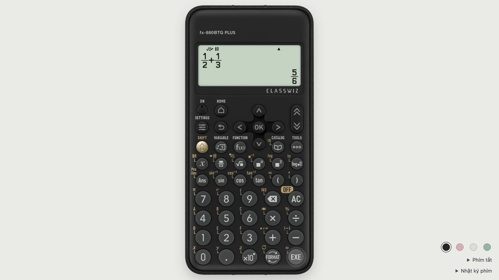

# fx-880BTG PLUS — demo cho team BITEX

**Phiên bản: 0.7.0-demo.2 · 20/11/2026**

**[Mở demo ngay](https://fx-880btg-plus-demo.dtran1904.chatgpt.site/)** — không cần đăng nhập. Nếu đang mở bản cũ, tải lại trang và kiểm tra phiên bản trong **Nhật ký phím**.

Bản demo có 14 ứng dụng chính, gồm Tính thường, Phương trình, Thống kê, Phân phối, Bảng tính, Ma trận, Vectơ, Khám phá Toán và Hộp Toán học. LCD đã chuyển sang SVG để giữ nét đồng đều khi đổi kích thước; dữ liệu chữ, số, dấu tiếng Việt, ký hiệu và con trỏ giữ theo mẫu PLUS đã quan sát trên ClassPad. Dòng CASIO đã được bỏ khỏi mặt máy theo yêu cầu của dự án.

## Góp ý và báo lỗi

Gửi một Issue trong kho GitHub, kèm mã bản, chuỗi phím tái hiện, ảnh màn hình và JSON từ **Nhật ký phím → Tải JSON**. Ghi rõ kỳ vọng lấy từ máy vật lý, đúng mẫu PLUS trên ClassPad hay tài liệu nào. Chi tiết ở [hướng dẫn kiểm tra](docs/TEAM_TESTING.md).

## Chạy trên máy cá nhân

Cần Node.js 18 trở lên; không cần cài thư viện.

```sh
node serve.js
```

Mở http://127.0.0.1:8870/ . Kiểm tra bằng `node --test test/*.test.js`. Đóng gói bằng `python3 tools/build-preview.py`; gói tạo ra trong `releases/`.

Bộ kiểm hiện có **6.689 ca đạt**, gồm **6.635 màn LCD** qua thao tác phím với kỳ vọng quan sát từ đúng mẫu PLUS trên ClassPad. Đây là số bằng chứng kiểm, không phải tỷ lệ giống toàn bộ máy. Xem [phạm vi và ca còn chờ](docs/DEMO_SCOPE.md).

Bản công khai dùng trực tuyến; khả năng lưu ngoại tuyến trên hosting này còn cần kiểm riêng. Ảnh TIFF gốc, PDF, Word và hồ sơ bàn giao đầy đủ được giữ trong hồ sơ dự án, không nằm trong bản chụp nguồn này. Tài nguyên web, font và mẫu kiểm cần để chạy đã có sẵn.


